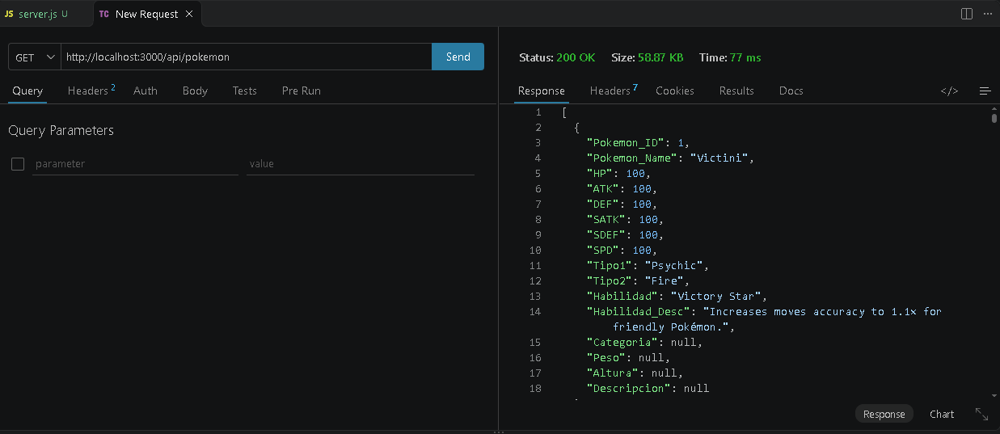

# Pokédex Región Teselia (Gen 5) - Proyecto Web con Acceso a Base de Datos

**Integrante:** Paolo Emilio Roche Albornoz  
**Carrera:** Desarrollo de Videojuegos  

## Descripción del Proyecto
Pagina web  que conecta una interfaz desarrollada con HTML5, CSS3, Bootstrap 5 y JavaScript a una base de datos relacional en MySQL (`Pokemon_gen5`) mediante una API construida con Node.js y Express.

## Instrucciones de Instalación y Ejecución

### 1. Base de Datos (MySQL Workbench)
1. Abrir MySQL Workbench.
2. Importar y ejecutar el archivo `Pokemon_gen5.sql` ubicado en la raíz de este repositorio para crear las tablas (`Pokemon`, `Pokemon_Types`, `Ability`, `Pokedex`) y cargar los 162 registros.

### 2. Backend (Servidor API)
1. Abrir una terminal dentro de la carpeta `backend/`.
2. Instalar las dependencias ejecutando:
   ```bash
   npm install

## Evidencia de Pruebas con Thunder Client
